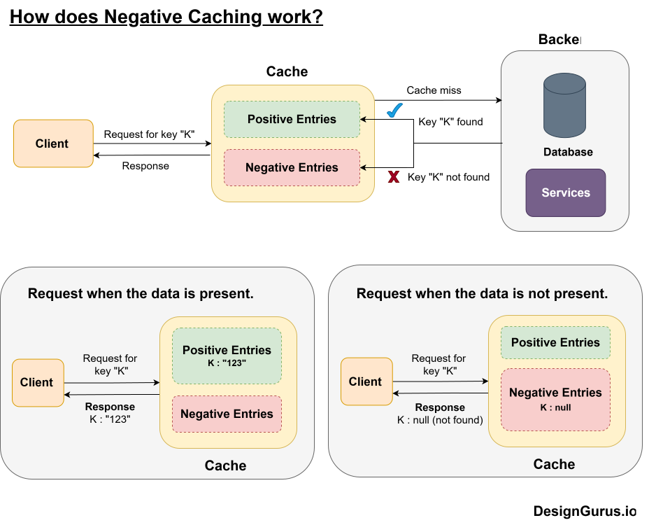

# Lesson 20: Negative Caching

## Overview

We have discussed various [caching methods](2026-01-20-Caching.md) and their trade-offs.
That discussion may have suggested that caching is only about real data. This need not be
the case: we can also cache negative results, e.g. a request that returned `404 Not Found`. This is called negative caching.

## Negative caching

Caching improves the latency of an application by serving data from a faster layer than
the database or the disk. Apart from caching existing data, we can also cache a failure or a "not found" result.
With negative caching we don't just store successful responses; we also cache certain errors, e.g. `404`s, or queries that return empty results, for a short time. This protects databases and upstream services from repeated, identical misses and failures, and cuts latency for repeated lookups. In other words, negative caching stops our system from performing the same failing operation over and over, which saves time and resources.

The following figure illustrates how negative caching works.

The main benefits of negative caching are [1]:

- Avoiding redundant requests
- Responding faster on errors
- Saving cost and resources
- Improving cache hit ratios

Common scenarios where negative caching is used include [1]:

- DNS lookup failures (non-existent domain names)
- HTTP `404` errors
- API errors and rate limiting
- Queries with empty result sets

### When should you cache 404s or empty results?

Negative caching is powerful, but it should be used judiciously. Caching `404`s or empty results makes sense only in certain situations [1]:

- **Repeated requests for the same missing item.** If an item is missing and many clients keep requesting it, caching the "not found" response pays off. For example, when a popular URL is removed, the first `404` can be cached and served to all subsequent users until it expires, instead of hitting the origin server every time. This often happens with bots or crawlers repeatedly requesting invalid URLs, or with users retrying a search.
- **Missing data is unlikely to appear soon.** If a `404` is truly a missing resource (e.g., a deleted page), or an empty query means "no data exists" rather than "temporarily empty", then a negative cache entry with a reasonable TTL is safe. A product ID that doesn't exist in your database is unlikely to appear in the next few seconds, so caching that miss for, say, a minute does little harm to consistency but saves a lot of work. The more stable the content, the more negative caching helps.
- **Failures are expensive to compute.** If finding out that something doesn't exist requires a complex database query or an extensive search, caching the empty result briefly means the next identical query returns quickly instead of re-running the heavy work. The costlier the operation, the bigger the gain.
- **High traffic and overload.** If your system, or an upstream service, is overloaded and returning errors (like `503 Service Unavailable` or `429 Too Many Requests`), caching those responses for a short time acts as a throttle and prevents flooding the service with identical failing requests. Even a few seconds of caching can stop thousands of clients from retrying continuously during an outage. Honouring the `Retry-After` header achieves a similar effect on the client side.

### When not to cache them

There are also cases where you should not cache `404`s or empty results, or should do so with great caution [1]:

- **Highly dynamic data.** If new content can appear at any moment, caching a "not found" leads to serving stale errors. In a fast-changing API where a resource may be created soon, clients should check the origin again so they don't miss the new data. As a rule of thumb, if an item could exist in the near future, keep the negative TTL very short or don't cache the miss at all. Negative caching harms correctness when the "not found" condition is transient.
- **Transient errors.** Don't cache transient errors like network timeouts or `500 Internal Server Error` responses (except perhaps for a few seconds). These should be retried, because the problem might be gone on the next attempt. Negative caching is best for consistent negative results, like truly non-existent data.

### Good practices

- **Use short TTLs.** When you do cache a negative result, give it a short time-to-live, on the order of seconds to a few minutes, depending on how quickly the situation could change. Short TTLs ensure that once the data appears, the negative entry expires soon and clients see fresh results. In DNS, the negative caching TTL is set by the zone's SOA record ([RFC 2308](https://www.rfc-editor.org/rfc/rfc2308)), and CDNs typically cache `404`s for a short default period unless configured otherwise. Always balance the performance gain against the risk of staleness.
- **Provide a way to invalidate.** If you implement negative caching in your own application, provide a way to purge entries. For example, when an administrator adds an item that was previously missing, purge the negative entry for that key so that users aren't stuck seeing "not found".

## Summary

::: {.callout-note title="Summary"}
Negative caching stores unsuccessful results, such as `404` responses or empty result sets, so that the system avoids repeating work that is known to fail. It is very useful when the same missing item is requested repeatedly, when the missing data is unlikely to appear soon, when failures are expensive to compute, or when an overloaded service needs protection. It should be avoided for highly dynamic data and transient errors, and negative entries should always have short TTLs and a way to be invalidated.
:::

## References

1. [What Is Negative Caching and When Should You Cache 404 or Empty Results?](https://www.designgurus.io/course-play/grokking-scalable-systems-for-interviews/doc/what-is-negative-caching-and-when-should-you-cache-404-or-empty-results)
2. [RFC 2308: Negative Caching of DNS Queries](https://www.rfc-editor.org/rfc/rfc2308)
