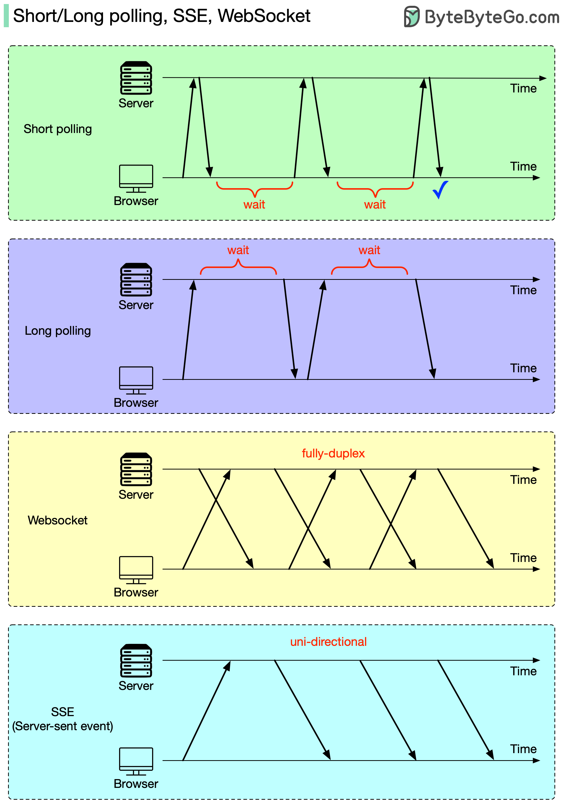

# Short Polling, Long Polling, SSE & WebSocket

An HTTP server cannot open a connection to a browser; the browser is always the initiator. So how can a browser get real-time updates from an HTTP server?

Either the browser or the browser and the server together can take care of it:

- **The browser does the heavy lifting: short polling or long polling.** With short polling, the browser repeatedly sends requests at a fixed interval, and the server responds immediately, with or without new data. With long polling, the server holds the request open and only responds when new data arrives (or a timeout expires), after which the browser immediately sends a new request.
- **The browser and the server cooperate: WebSocket or SSE (server-sent events).** In both cases, once the connection is established, the server can push new data to the browser directly. The difference is that SSE is unidirectional: the stream only carries events from the server to the browser, so the browser has to use separate HTTP requests to send data to the server. WebSocket is full-duplex: the browser and the server can both send messages over the same connection at any time.
